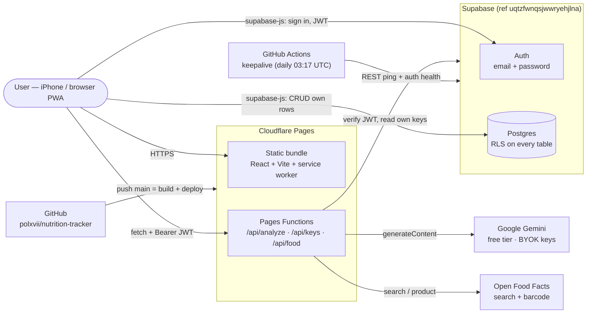
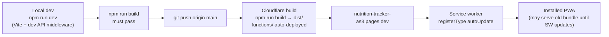
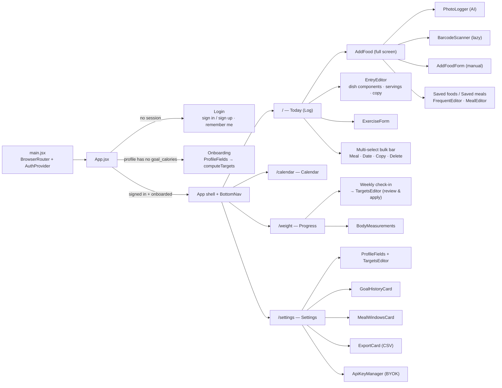
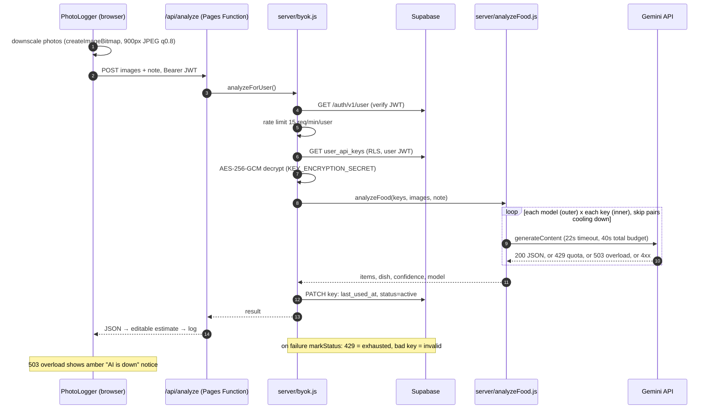
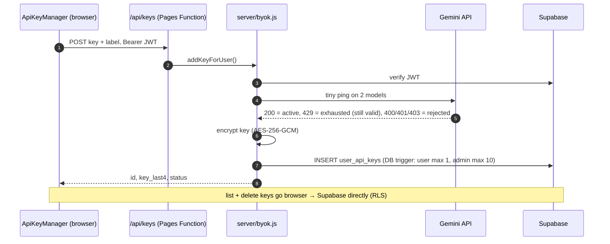
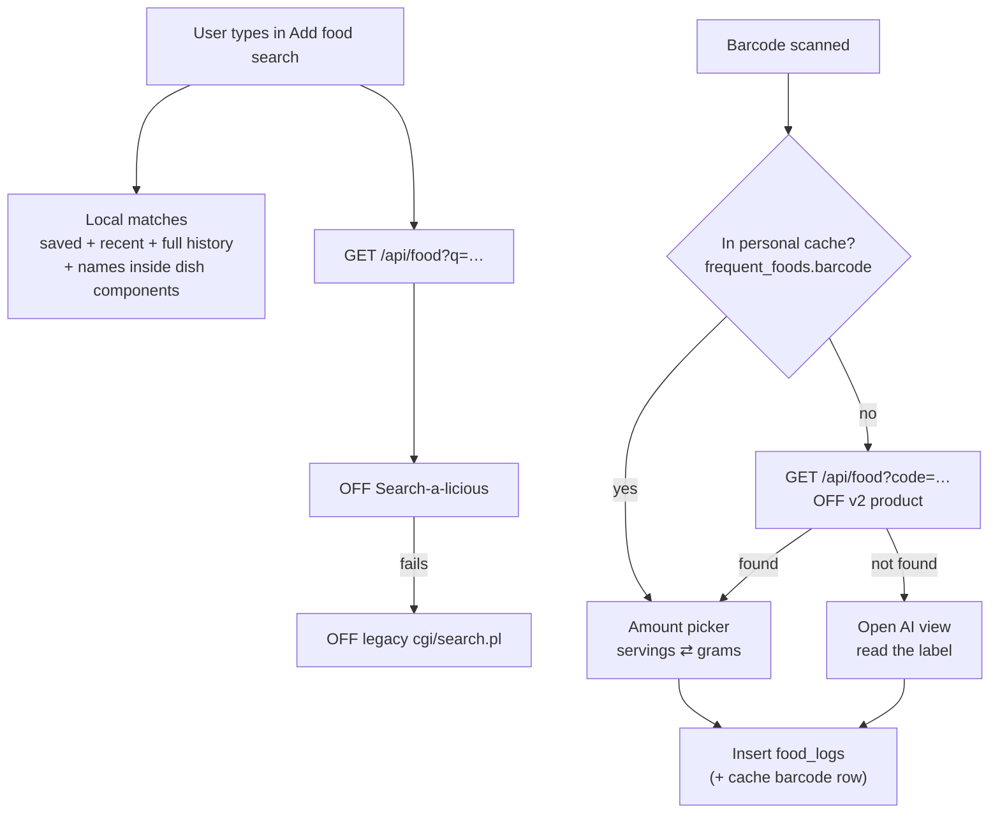
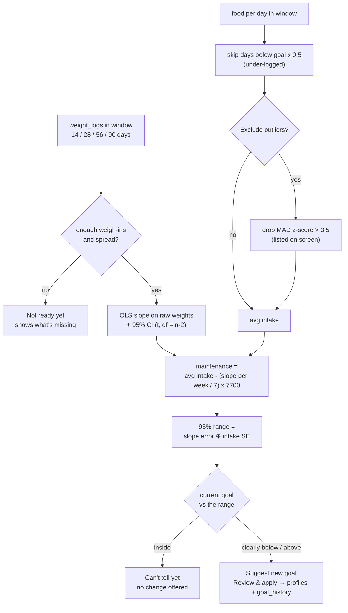
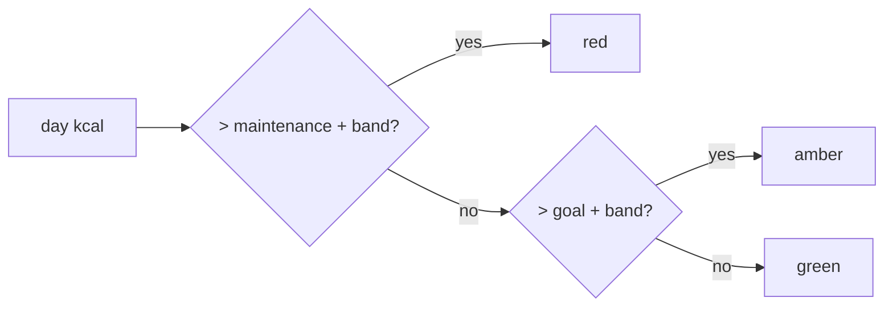
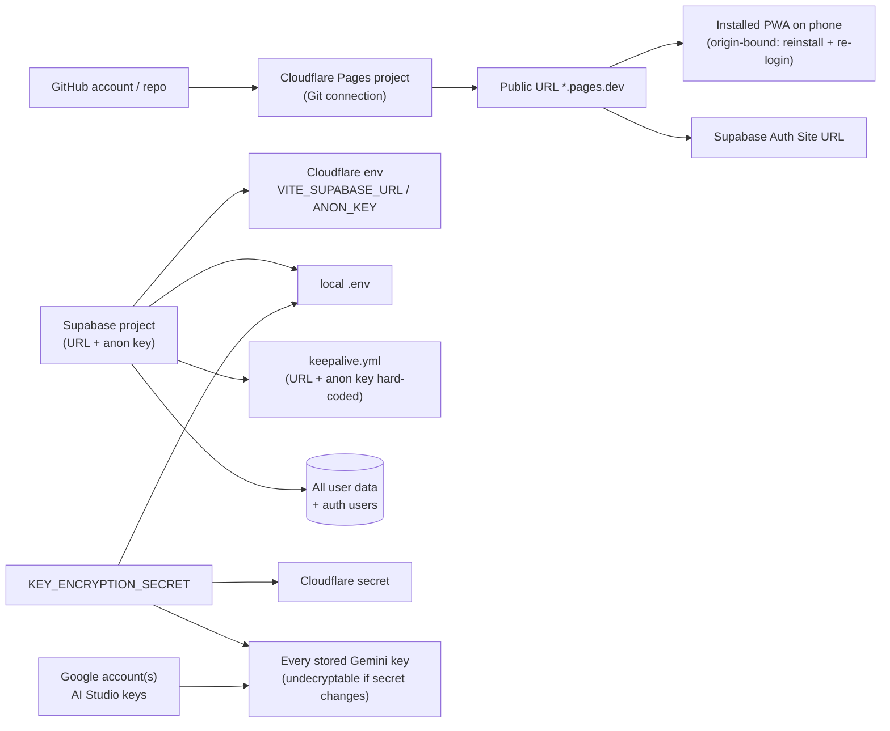

# Nutrition Tracker — Architecture diagrams

> อัปเดตล่าสุด: 2026-10-15 · diagram เขียนด้วย Mermaid (GitHub render ให้อัตโนมัติ)
> ดูแบบไม่ต้องขึ้น GitHub: เปิด [architecture.html](architecture.html) ใน browser (สร้างจากไฟล์นี้ด้วย `node docs/build-diagrams.mjs`)
> **ไฟล์นี้คือต้นฉบับ** — แก้ที่นี่แล้วรันสคริปต์ใหม่ อย่าแก้ html ตรง ๆ

---

## 1. System context — ทุกอย่างคุยกับอะไร

- Browser คุยกับ Supabase **ตรง** สำหรับข้อมูลทั่วไป (RLS คุมสิทธิ์) — ไม่ผ่าน Functions
- Functions ใช้เฉพาะงานที่ต้องมีความลับฝั่ง server (ถอดรหัส Gemini key) หรือเลี่ยง CORS (Open Food Facts)
- Functions เรียก Supabase ด้วย **JWT ของผู้ใช้เอง** (ไม่มี service_role) → RLS ยังคุมอยู่

## 2. Build + deploy pipeline

## 3. Frontend map — routes, pages, components

Shared libs: `lib/tiers.js` (สี green/amber/red ทุกหน้า) · `lib/goalHistory.js` (เป้าตามวัน) · `lib/nutrition.js` (BMR/TDEE/macro) · `lib/macros.js` (alcohol) · `lib/mealWindows.js` (meal ตามเวลา) · `components/ui.jsx` (Button/Card/Field/Input/Select/Collapsible)

## 4. AI meal analysis — sequence (BYOK)

## 5. Adding a Gemini key — sequence

## 6. Food search + barcode flow

## 7. Database — ER diagram

```mermaid
erDiagram
  AUTH_USERS ||--|| PROFILES : "id = id"
  AUTH_USERS ||--o{ FOOD_LOGS : logs
  AUTH_USERS ||--o{ FREQUENT_FOODS : saves
  AUTH_USERS ||--o{ SAVED_MEALS : combos
  AUTH_USERS ||--o{ WEIGHT_LOGS : weighs
  AUTH_USERS ||--o{ BODY_MEASUREMENTS : measures
  AUTH_USERS ||--o{ GOAL_HISTORY : "goal periods"
  AUTH_USERS ||--o{ USER_API_KEYS : "BYOK keys"

  PROFILES {
    uuid id PK
    text email
    int age
    numeric weight_kg
    numeric height_cm
    text sex
    numeric body_fat_pct
    text activity_level
    text goal_type "recomp cut bulk maintain"
    text goal_rate "slow medium fast"
    int bmr
    int tdee
    int goal_calories
    int goal_protein_g
    int goal_carbs_g
    int goal_fat_g
    numeric goal_weight_kg
    text role "user or admin, set by SQL only"
    jsonb meal_windows
  }
  FOOD_LOGS {
    uuid id PK
    uuid user_id FK
    timestamptz logged_at
    text meal_type "breakfast lunch dinner night snack"
    text food_name
    text source "manual frequent ai barcode search meal exercise"
    numeric grams
    text unit "g or ml"
    numeric calories
    numeric protein_g
    numeric carbs_g
    numeric fat_g
    numeric alcohol_g
    jsonb components "dish breakdown"
    numeric servings
    numeric serving_g
    text ai_confidence
  }
  FREQUENT_FOODS {
    uuid id PK
    uuid user_id FK
    text food_name "unique per user"
    numeric default_grams
    text unit
    numeric calories
    numeric protein_g
    numeric carbs_g
    numeric fat_g
    numeric alcohol_g
    numeric serving_g
    text barcode "set = barcode cache row"
    int times_used
  }
  SAVED_MEALS {
    uuid id PK
    uuid user_id FK
    text name
    jsonb items
  }
  WEIGHT_LOGS {
    uuid id PK
    uuid user_id FK
    date logged_date "unique per user"
    numeric weight_kg
  }
  BODY_MEASUREMENTS {
    uuid id PK
    uuid user_id FK
    date logged_date "unique per user"
    jsonb measurements "waist chest arms thighs hips"
  }
  GOAL_HISTORY {
    uuid id PK
    uuid user_id FK
    date effective_from "unique per user"
    int goal_calories
    int goal_protein_g
    int goal_carbs_g
    int goal_fat_g
    int tdee
  }
  USER_API_KEYS {
    uuid id PK
    uuid user_id FK
    text provider "gemini"
    text encrypted_key "base64 iv . base64 ct"
    text key_last4
    text key_label
    text status "active exhausted invalid"
    timestamptz last_used_at
  }
```

ทุกตาราง: RLS `auth.uid() = user_id` · `anon` ไม่มีสิทธิ์ · `authenticated` CRUD

## 8. Weekly check-in — วิธีคำนวณ measured maintenance

## 9. Calorie colour tiers (ใช้ร่วมทุกหน้า)

`band` (เฉพาะวันเดียว, ค่าเฉลี่ยไม่มี band) = `clamp(deficit x 0.30, goal x 2%, goal x 5%)` โดย deficit = maintenance − goal · protein: แดงเมื่อ < 75% ของเป้า · carbs/fat: แดงเมื่อ > 125%

## 10. Account dependency map — เปลี่ยนอะไรแล้วกระทบอะไร

รายละเอียดขั้นตอนดูที่ [ACCOUNT_MIGRATION.md](ACCOUNT_MIGRATION.md)
